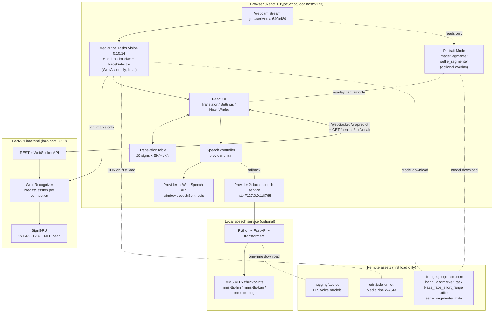
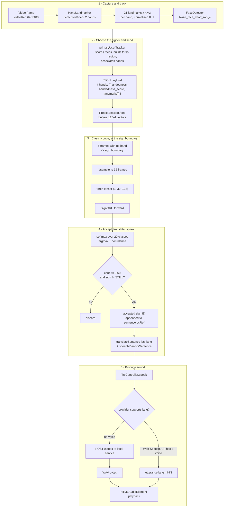
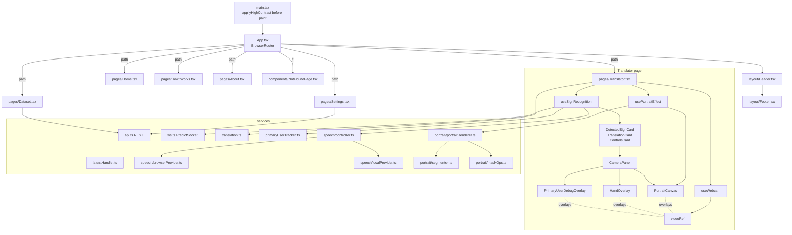
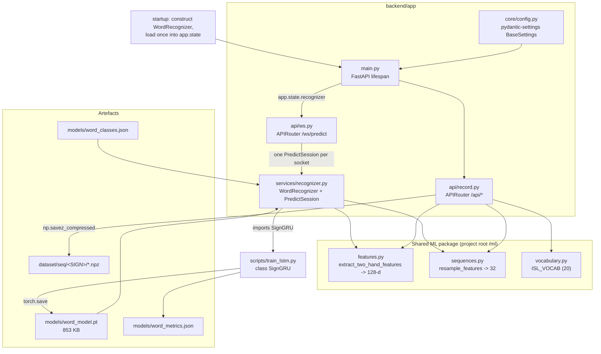
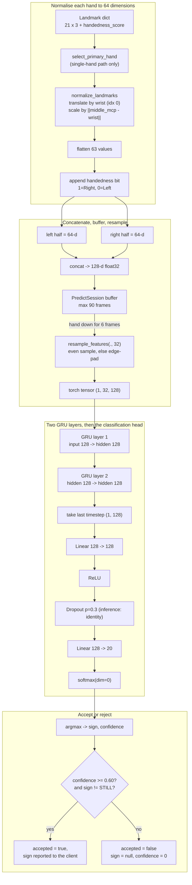
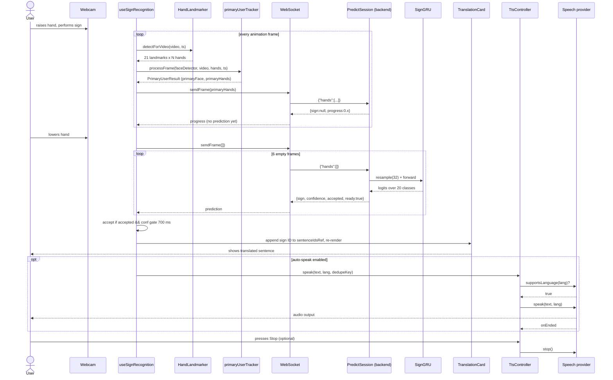
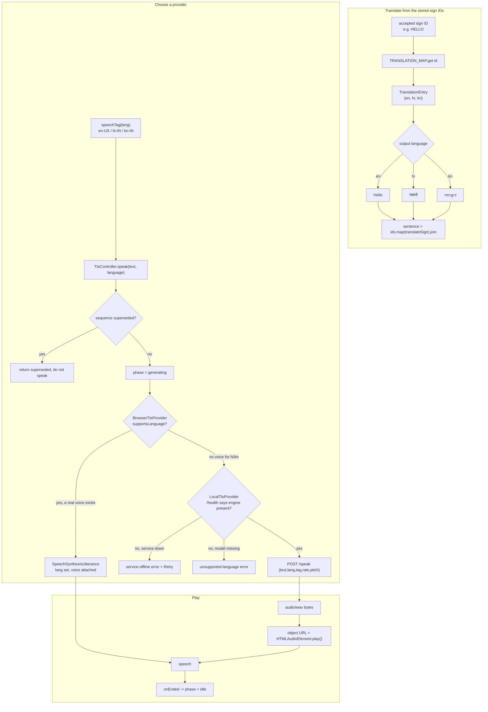
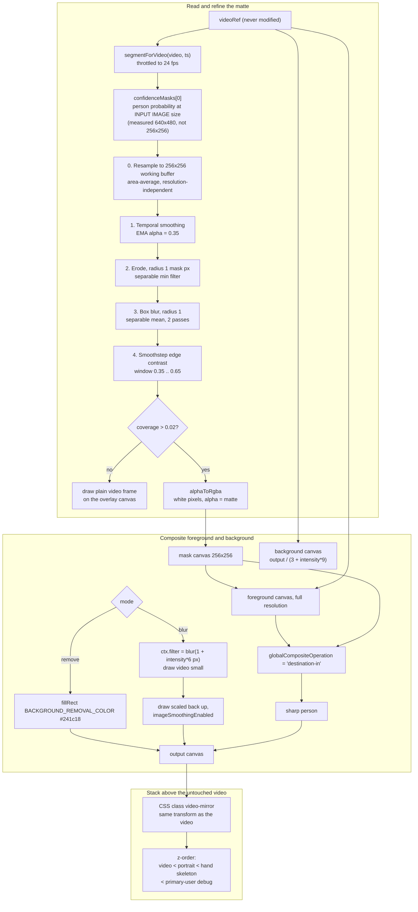
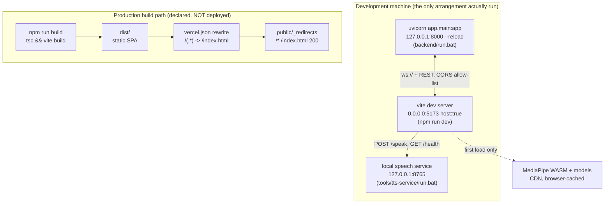
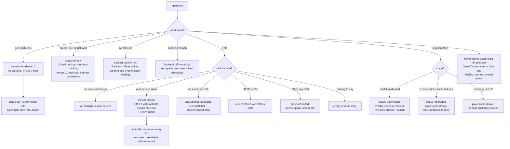

# Architecture Diagrams — ISL-to-Speech

Nine Mermaid diagrams describing the **as-built** system. Every relationship shown
here exists in the code; where the code is absent, the diagram is absent too.

Verified against: `backend/app/`, `ml/`, `scripts/`, `models/word_model.pt`,
`frontend/src/`.

---

## Diagram A — High-level system architecture

**Explanation.** Three processes, all local to one machine. The browser does all
computer vision; the backend only classifies pre-extracted landmarks; the speech
service is optional and exists solely to synthesise languages the operating
system cannot. Video pixels never leave the browser — only 21-point coordinates
cross the network.

---

## Diagram B — Complete sign-to-speech data flow

**Explanation.** The decisive design choice is at step G: the backend predicts
**once per sign**, not once per frame. A sign is buffered while the hand is up
and classified when the hand is lowered, which removes mid-sign and
raise/lower-transition predictions — the largest source of wrong live output.

---

## Diagram C — Frontend component architecture

**Explanation.** The page owns two hooks that each own one long-lived resource:
`useWebcam` owns the `MediaStream`, `useSignRecognition` owns the MediaPipe
models and the WebSocket. `usePortraitEffect` deliberately reads `videoRef`
but never writes to it, which is what keeps the recogniser on original pixels.

---

## Diagram D — Backend architecture

**Explanation.** `app.state.recognizer` is created once in the FastAPI lifespan
handler, so the 217 k-parameter model is loaded once per process, not per
connection. Each WebSocket connection gets its own `PredictSession`, which is
what keeps two users from corrupting each other's sign buffers. The backend
reuses the same `ml.features` and `ml.sequences` functions as training, so the
inference feature format cannot drift from the training format.

---

## Diagram E — Machine-learning inference pipeline

**Explanation.** Normalisation is what makes the classifier distance- and
scale-invariant: subtracting the wrist removes translation, dividing by the
wrist-to-middle-knuckle distance removes scale. The two-hand concatenation
preserves the full signal of two-handed signs; an absent hand contributes a
zero half, which the network learns to read as "not present".

---

## Diagram F — Sequence diagram: camera input to spoken output

**Explanation.** Note the asymmetry that the design deliberately introduces: the
frontend receives a `progress` value every frame but a prediction only once,
at the end of the sign. This keeps the GPU/CPU free and, more importantly,
stops the recogniser from committing to a sign before it is finished.

---

## Diagram G — Translation and text-to-speech workflow

**Explanation.** Two crucial rules are enforced. First, translation always
derives from the stored sign IDs, never from a previously translated string, so
switching language re-renders the whole sentence correctly. Second, a voice is
never borrowed across languages — if no Kannada voice exists, nothing is
dispatched to the browser engine, because an English voice reading Kannada
script produces noise. The controller falls through to the offline service
instead.

---

## Diagram H — Portrait Mode rendering pipeline

**Explanation.** The whole feature is one canvas between the video and the hand
skeleton. Because MediaPipe hand landmarks are read from the `<video>` element
and never from this canvas, the recogniser is structurally incapable of seeing
a blurred or segmented frame. Erosion at step 2 is what removes the halo: the
outermost ring of any segmentation mask is a mixture of person and background,
and showing it verbatim paints the old background onto the silhouette.

---

## Diagram I — Development and deployment topology

**Explanation — read this honestly.** The production side of this diagram is a
**declared capability, not an observed deployment**. `vercel.json` and
`public/_redirects` configure an SPA-hosting target, and `vercel.json` contains
no hosting provider, no project id and no URL. Nothing in the repository
records that the application has ever been deployed. The development topology
on the left is the only arrangement that has actually been run.

When the frontend is served from an origin other than the backend, the operator
must add that origin to the backend's `ALLOWED_ORIGINS`, otherwise the browser
blocks the requests. When the frontend is built for production,
`API_BASE` falls back to `window.location.origin`, so a same-origin deployment
needs no hard-coded URL and an HTTPS deployment automatically derives `wss://`.

---

## Diagram J — Error-handling and degradation flow

**Explanation.** Every failure path ends in an honest, specific message with a
concrete next step. The three TTS failure kinds are deliberately distinct —
`service-offline`, `unsupported-language` and `request-failed` require different
user actions, so collapsing them into one generic warning would be uninformative.
The system never reports success without audio: `SpeakOutcome.ok` is only true
when a provider actually returned a usable result.